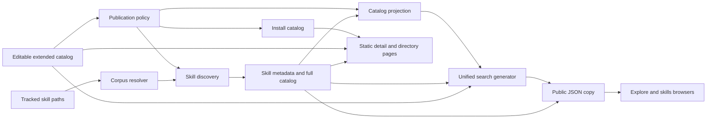

<!-- doc-class: record -->

# Marketplace discovery baseline

Date: 2026-10-25. Bead: `claude-qyxc.1.1`.
Source revision: `55ea040716904ce8199516ddb0c3a0500aa4e172`.
Machine evidence: [832a-RA-DATA-discovery-baseline.json](832a-RA-DATA-discovery-baseline.json).

This is a dated source baseline for discovery, using the operator-audit method. It is not a full estate playbook, a production deployment attestation, an accessibility certification, or approval for the discovery pilot. It does not adopt a new ontology, ranking policy, telemetry policy, or compatibility claim. Parent decisions remain separate.

## 1. Discovery in five minutes

The marketplace provides three main discovery routes. `/plugins/` is a static category directory. `/explore/` searches plugins, skills, and documentation together after downloading a generated JSON index. `/skills/` initially renders 24 skills, then downloads its catalog and appends the remainder. Plugin and skill detail pages are static build outputs. The route owners are listed in section 5.

The editable catalog is not the browser search index. Publication policy filters the editable catalog, skill discovery resolves the visible source cohort, and generators construct the site projections. The build copies two JSON projections into public assets. A successful source analysis does not establish that production serves those exact bytes.

At this revision there are 434 editable catalog entries, 431 public plugin entries, 429 distinct public source paths, 2,785 visible skill paths, and 24 indexed documents. The combined search index therefore has 3,240 rows. The graded cohort contains 3,376 skill paths and is a different denominator. These are measured cohorts, not interchangeable product totals.

The largest observed discovery cost is the skills page's catalog fetch: 22,697,053 uncompressed bytes. The browser discards the content fields when constructing its card data, but only after downloading and parsing them. The separate metadata index is substantially smaller and is not the input to that fetch. This is a source and payload observation, not measured device latency.

## 2. Scope and operational status

This baseline inspects main as observed at collection and its tracked projections. Unmerged authentication and Apple Notes retirement work is outside the source revision. No site build, production deployment, browser session, analytics query, provider call, or skill execution was performed for this measurement.

The companion evidence hashes the selected source inputs listed in the companion. Every hash was checked against `git show` at the source revision before recording facts. It also records the measured file sizes, local gzip estimates, cohort counts, route contracts, and explicit unknowns.

Governed-brain retrieval returned a historical description of Astro 5.16, 244 skills, and 259 plugins: `qmd://kb-guides/ea6e2e59-35f9-5596-9817-96fa44de67f5.md`. That archival memory is not current numerical authority. The frozen source manifest instead declares Astro 7.3.3; all counts here come from this revision's inputs.

## 3. Data path and fact ownership



| Fact class                                | Authority and reproducible owner                      | Consumer / boundary                                                                    |
| ----------------------------------------- | ----------------------------------------------------- | -------------------------------------------------------------------------------------- |
| Plugin registration and declared metadata | `.claude-plugin/marketplace.extended.json`            | Editable source; includes quarantined records                                          |
| Public inclusion                          | `scripts/publication-policy.cjs:14`                   | Missing publication state is public; quarantined is excluded; unknown states throw     |
| Install catalog                           | `scripts/sync-marketplace.cjs`                        | `.claude-plugin/marketplace.json`; static plugin routes intersect its names            |
| Skill membership                          | `scripts/corpus-resolver.mjs`                         | Explicit `graded` and `marketplace-visible` cohorts                                    |
| Skill metadata and content                | `marketplace/scripts/discover-skills.mjs:449`         | `skills-index.json` and `skills-catalog.json`; parent attribution and source filtering |
| Website plugin rows                       | `marketplace/scripts/sync-catalog.mjs:90`             | `catalog.json`; unique identity/source and skill-parent checks                         |
| Combined searchable rows                  | `marketplace/scripts/generate-unified-search.mjs:350` | `unified-search-index.json`; plugin + skill + documentation rows                       |
| Browser asset copies                      | `marketplace/scripts/copy-public-data.mjs:74`         | Untracked `public/data/` assets; not a second editable catalog                         |
| Build order                               | `marketplace/scripts/build.mjs:25`                    | Discovery, README extraction, catalog, search, Cowork, public data, Astro              |

The browse directory cohort is explicitly the editable rows whose names occur in the install catalog. The measured intersection has 431 rows with exactly the install catalog name set; it contains 429 distinct source paths and 19 distinct category values. The companion records these intersection-specific denominators, and the recipe below computes them directly.

The three quarantined entries are Skyvern, Hyperflow, and llm-box. Their records remain in the editable catalog for provenance; they are not public install entries. The 431 public entries map to 429 source paths, so a catalog-row count is not a count of unique plugin directories.

## 4. Architectural tradeoffs

**Static pages plus browser search.** Static plugin and skill details avoid a request-time application database. Explore instead depends on JavaScript and one JSON download before showing results. The cost is an empty result surface when the fetch fails or JavaScript does not execute. Reconsider this boundary if a no-JavaScript discovery journey becomes a requirement. No historical decision rationale beyond the code comments is inferred.

**Full skill catalog reused for browsing.** One rich catalog supports detail generation and supplies the browser's lightweight cards. That reduces separate consumer contracts, while imposing download and parse costs for content the card view omits. A metadata catalog already exists. Selecting it for the browser would require a separately tested consumer change, not a hand edit of generated JSON.

**Category-based related items.** Detail pages take the first six other entries in the same category. This is understandable and deterministic in catalog order. It does not establish task fit, interoperability, semantic equivalence, quality, or safety. A future relationship builder must not relabel this ordering as evidence of those properties.

**Deterministic tracked projections, build-time public timestamp.** Removing wall-clock values from tracked discovery projections avoids unrelated Git conflicts. Only the public full skill catalog receives `generatedAt`, with `SOURCE_DATE_EPOCH` supported. Its date means public-copy build time, not upstream review or behavioral evaluation time.

## 5. Present user journeys

| Journey                  | Source owner                                    | Present behavior and limit                                                                           |
| ------------------------ | ----------------------------------------------- | ---------------------------------------------------------------------------------------------------- |
| Homepage → discovery     | `marketplace/src/pages/index.astro:209`         | Browse link leads to Explore; navigation also exposes skills and docs                                |
| Browse plugins           | `marketplace/src/pages/plugins/index.astro:13`  | Public install-name intersection, grouped by category; ordinary links work without search JavaScript |
| Search and filter        | `marketplace/src/pages/explore.astro:465`       | Local Fuse search at threshold 0.3; type, author, category, keyword, tool, and sort controls         |
| Share a filtered view    | `marketplace/src/pages/explore.astro:566`       | URL records query, type, category, keyword, and sort; omits tool and author filters                  |
| Open a search result     | `marketplace/src/pages/explore.astro:587`       | Plugin → plugin detail; docs → document URL; a skill with a parent → `/cowork`, not its skill detail |
| Browse individual skills | `marketplace/src/pages/skills/index.astro:16`   | First 24 cards static; full-catalog fetch then remaining cards; links lead to skill details          |
| Evaluate plugin details  | `marketplace/src/pages/plugins/[name].astro:14` | Public plugin, extracted README, embedded skill list, install command, same-category related plugins |
| Evaluate skill details   | `marketplace/src/pages/skills/[slug].astro:7`   | Generated skill route, parent-plugin install command, first six same-category related skills         |

The three main catalog routes are not the whole discovery estate. These secondary entrypoints have different owners and cohorts:

| Surface                              | Source owner                                                                                    | Data and present journey                                                                                                                                                                                          |
| ------------------------------------ | ----------------------------------------------------------------------------------------------- | ----------------------------------------------------------------------------------------------------------------------------------------------------------------------------------------------------------------- |
| Collections, spotlight, stash, stack | `marketplace/src/pages/collections.astro:3` and its four imported feature components            | `collections.json`, `spotlights.json`, and `jeremys-stash.json` are editorial inputs. Stack Builder stores `ccp-plugin-stack` and shares a `stack` URL parameter; it does not infer interoperability.             |
| Cowork downloads and search          | `marketplace/src/pages/cowork.astro:7`, `CoworkGrid.astro`, `scripts/build-cowork-zips.mjs:263` | Generated manifest and ZIP artifacts; individual plugin name/category substring filtering. Package-local counts are not the public catalog denominator. No archives were rebuilt or downloaded for this baseline. |
| Side-by-side comparison              | `marketplace/src/pages/compare.astro:451` and `CompareBar.astro`                                | Lookup inlined from unified items; `items` query selection takes precedence over `compare-items` local storage. Empty selection has a browse CTA. Displayed metadata does not establish compatibility.            |
| Community                            | `marketplace/src/pages/community.astro:11`                                                      | Groups public unified plugin items by author/contributor. Its historical spotlight hall-of-fame is filtered to currently published plugin slugs.                                                                  |
| Docs                                 | `marketplace/src/pages/docs/index.astro:5` and `docs/[...slug].astro`                           | Astro docs collection grouped by section/order. Footer numbers explicitly marked historical-copy are not current catalog totals.                                                                                  |
| Learning, playbooks, research        | `learning/index.astro`, `playbooks/index.astro`, `research.astro`                               | Route-local guide/notebook/reference lists. Their declared durations and word counts were not measured here; they are not catalog relationship evidence.                                                          |
| Specialized/editorial directories    | `skill-enhancers.astro`, `tools.astro`, `compare-marketplaces.astro`                            | Promotional/tool entrypoints and comparison copy; marketplace-comparison totals read unified stats. External comparison claims are not validated by this audit.                                                   |
| Work diary                           | `blog/index.astro` and `blog/[...slug].astro`                                                   | Astro blog-posts collection and article routes. Blog posts are a separate content cohort, not the 24 indexed documentation rows.                                                                                  |

The companion hashes the selected page, component, data, and generator inputs behind these routes. It does not enumerate or validate every external editorial destination or every article body.

Explore and the skills directory therefore offer different destinations for an embedded skill. This is a current journey difference; this baseline does not assume whether that product choice should remain.

## 6. Reproduce the measurements

Use a checkout containing this record and Git history containing the source revision, Node 22.12+ and Python 3. The verifier allows the later documentation commit but refuses differing source-input bytes. No provider, package installation, build, or production access is necessary for the following measurements.

```bash
git rev-parse HEAD
node scripts/corpus-resolver.mjs --cohort graded --cohort marketplace-visible --json
python3 - <<'PY'
import collections, gzip, hashlib, json, subprocess
from pathlib import Path
receipt = json.loads(Path('000-docs/832a-RA-DATA-discovery-baseline.json').read_text())
revision = receipt['source_commit']
assert subprocess.check_output(['git', 'cat-file', '-t', revision], text=True).strip() == 'commit'
subprocess.run(['git', 'merge-base', '--is-ancestor', revision, 'HEAD'], check=True)
for path, expected in receipt['source_inputs'].items():
    blob = subprocess.check_output(['git', 'show', revision + ':' + path])
    assert hashlib.sha256(blob).hexdigest() == expected['sha256'], path
    assert len(blob) == expected['bytes'], path
    assert Path(path).read_bytes() == blob, path
print('verified_inputs', len(receipt['source_inputs']), 'source_commit', revision)
paths = [
    '.claude-plugin/marketplace.extended.json',
    '.claude-plugin/marketplace.json',
    'marketplace/src/data/catalog.json',
    'marketplace/src/data/skills-index.json',
    'marketplace/src/data/skills-catalog.json',
    'marketplace/src/data/unified-search-index.json',
]
for path in paths:
    raw = Path(path).read_bytes()
    value = json.loads(raw)
    print(path, len(raw), len(gzip.compress(raw, mtime=0)))
    for key in ('plugins', 'skills', 'items'):
        if key in value:
            print(key, len(value[key]))
    if 'items' in value:
        print(collections.Counter(row['type'] for row in value['items']))
public = json.loads(Path('.claude-plugin/marketplace.json').read_text())
extended = json.loads(Path('.claude-plugin/marketplace.extended.json').read_text())
names = {row['name'] for row in public['plugins']}
browse = [row for row in extended['plugins'] if row['name'] in names]
assert len(browse) == len(public['plugins']) and {row['name'] for row in browse} == names
print('browse intersection', len(browse))
print('browse unique source paths', len({row['source'] for row in browse}))
print('browse categories', len({row['category'] for row in browse}))
items = json.loads(Path('marketplace/src/data/unified-search-index.json').read_text())['items']
ids = collections.Counter(row.get('id') or row['name'] for row in items)
print('compare raw-ID keys', len(ids))
print('compare duplicate raw IDs', sum(count > 1 for count in ids.values()))
PY
```

The verifier binds each selected input to the named Git commit and refuses a checkout whose input bytes differ. The source revision is an ancestor of the initial PR candidate; the companion records the observed main/base identities and UTC timestamp. This selected set includes the named catalog and README writers and the recommended regeneration entrypoint; it is not a full transitive build-input attestation.

The JSON companion records the executed recipe output and names local documentation checks with result summaries and initial-candidate CI links. Those local summaries are author-reported execution receipts; they are not independent certification. The final PR head still requires its own hosted gates. The JSON companion specifies the collection toolchain. A gzip estimate is a local compression measurement; actual HTTP compression and cache behavior require a separate deployment measurement. To check projection drift without writing them, use `node scripts/regenerate-after-bump.mjs --check`. To reproduce public-copy timestamps in a disposable checkout, use `SOURCE_DATE_EPOCH` with `marketplace/scripts/copy-public-data.mjs`; do not commit `marketplace/public/data/`.

## 7. Freshness and failure operations

Build order is load-bearing. `marketplace/scripts/build.mjs` stops on a failed subprocess before later steps. `marketplace/package.json` also runs the README extraction and public-copy steps before development, preventing fresh-clone runtime JSON 404s caused by missing copies. The public copies are deliberately untracked.

Explore's fetch catch replaces the loading message with “Failed to load catalog. Please refresh.” It provides no static result list or automatic retry. Its `aria-busy` reset occurs only on success (`explore.astro:477–483`). The skills page retains its initial static cards when loading additional data fails and replaces the additional-loading message (`skills/index.astro:324`). These are different failure contracts.

Both browser routes call `response.json()` without an explicit `response.ok` check at these sites (`explore.astro:465–466`, `skills/index.astro:300–301`). This observation is not proof that every server error is silently accepted: JSON parsing and downstream operations can also throw. No production HTTP error response was induced.

External popularity statistics have a separate freshness owner, `scripts/check-stats-freshness.mjs:54`, covering GitHub, npm, and skills.sh snapshot files. Its age bound must not be substituted for discovery-catalog freshness. A successful freshness check also does not prove the current deployed revision.

## 8. Native-extension and trust boundaries

At this revision every projected plugin row has `type: instruction-plugin`, because `sync-catalog.mjs:215` assigns that value. The browser index uses `plugin`, `skill`, and `docs` item types. Neither vocabulary proves that all components are portable instructions or that native extensions are absent. Cowork packaging provides a separate concrete boundary: `scripts/build-cowork-zips.mjs:263` starts from published catalog rows and its loop skips the MCP directory category (`:319`). That rule is not a universal detector of native behavior in other categories. `cowork.astro:7–17` requires generated manifest fields, and `scripts/validate-cowork-manifest.mjs` owns the package consistency gate; neither a ZIP nor a directory label certifies runtime compatibility.

The CLI separately records harness support classes, including `native-extension`, in `packages/cli/src/commands/skills.ts:12`. The hashed Explore template exposes no harness-support or native-component filter in its control block or filter-state implementation (`explore.astro:384–435`, `491–540`). Its tool filter matches declared skill `allowedTools`, which is not proof that a target harness implements those tools. Detail component counts and MCP-tool counts are descriptive metadata, not an execution or compatibility test.

Cards show Claude plugin install commands. Preserving the legacy marketplace identifier is intentional repository compatibility, not evidence of a cross-harness install route. Registration, byte identity, a static grade, a native launch check, and behavioral fitness remain separate fact classes.

## 9. Privacy and security observations

Explore's search handler passes query text to optional `window.trackEvent` after its debounce (`explore.astro:684–690`). `marketplace/public/scripts/analytics.js:5` forwards events to optional Umami, and `BaseLayout.astro:100` loads the site's analytics script. No visitor query, telemetry stream, or analytics credential was accessed here. A future aggregate-only learning pilot must resolve this existing data path explicitly rather than assume that the current search interface already provides aggregate-only capture.

Explore and skill-card renderers escape HTML string values before insertion (`explore.astro:581–584`, `skills/index.astro:329–332`). Compare state is read from local storage (`CompareBar.astro:210`); that component also documents escaping stored values before rendering. These observations are narrower than an XSS audit and do not establish safe behavior for every content producer or dependency.

No production secrets, personal installation state, private corpus content, or user-authored files are included in the evidence. The governed-memory citation identifies historical context; no raw governed document was copied into the public artifact.

## 10. Performance and accessibility constraints

| Tracked input             | Uncompressed bytes | Local gzip bytes | Relevant consumer                                                 |
| ------------------------- | -----------------: | ---------------: | ----------------------------------------------------------------- |
| Unified search index      |          3,921,913 |          521,168 | Explore fetch                                                     |
| Full skill catalog        |         22,697,053 |        5,083,649 | Skills fetch and static detail generation                         |
| Skill metadata index      |          1,793,536 |          299,889 | Available metadata projection; not used for the skills-page fetch |
| Plugin catalog projection |            363,221 |           46,048 | Build-time catalog consumers                                      |

Explore inserts every matched card into the DOM (`explore.astro:645`); the skills directory appends every remaining card (`skills/index.astro:321`). The initial 24-card render is not ongoing client pagination or virtualization. These facts define payload and DOM work; no latency, memory, throughput, or cost target is inferred.

The skills directory has explicit labels for its search and filter controls. Explore's main search and selects have no explicit label or `aria-label` in that template (`explore.astro:355–430`). Explore has a polite live region and a busy state, plus slash/j/k/Enter navigation. Its keyboard exclusion checks input and textarea, not select (`explore.astro:795`); interaction with native select keys needs runtime review. These are source review observations, not measured screen-reader or WCAG results.

## 11. Findings and evidence limits

The machine companion records D01–D09 with source owners. They cover full-catalog payload reuse, failure/busy-state handling, incomplete filter URL round trips, accessible-name review, different skill destinations, category-only recommendations, raw-query telemetry prerequisites, and the limits of current broad E2E assertions.

A further deterministic failure mode appears in comparison identity: the 3,240 unified rows contain 31 raw IDs shared by a plugin and a skill. The `Map` / `Object.fromEntries` lookup keyed only by raw ID in `compare.astro:6,451` therefore has 3,209 keys, with later entries replacing earlier ones. The companion lists the collisions and the recipe reproduces both counts. This is a source/data collision finding; browser behavior for a particular saved or shared selection was not tested, and no identifier migration is applied here. Remediation is tracked in `claude-dww0`.

Existing `marketplace/tests/T7-explore-plugin-flows.spec.ts` includes fixed waits and broad card/body assertions. Its existence does not establish ranking correctness, failure recovery, or an accessibility/performance budget. It was read, not executed, for this baseline. No prior test receipt is relabeled as a new runtime measurement.

Production deployment identity, HTTP cache/compression headers, slow-device timings, p50/p95/p99 latency, keyboard/screen-reader outcomes, and recommendation effectiveness are unmeasured. A health score would conceal those gaps, so none is assigned.

## 12. Follow-up boundaries

Use this artifact as input to the existing discovery research and synthesis graph. Before any implementation, decide the intended user journey, compatibility vocabulary, ranking explanation, and privacy requirements in their owning beads. Specific measurement follow-ups are a cold-load payload/DOM trace, isolated failed-fetch and no-JavaScript journeys, filter URL round-trip checks, and keyboard/accessibility review.

Those are proposed evidence-gathering steps, not a new deployment plan or acceptance-policy change. This baseline does not approve the pilot, activate a new graph, change public badges, transmit new analytics, rebuild native extensions, or replace existing catalog authorities.

## 13. Acceptance and quick reference

The dated artifact and hashed companion provide canonical-writer/projection separation, current journeys and gaps, reproducible counts, source owners, freshness behavior, extension boundaries, and explicit runtime unknowns. The delivery still needs normal PR acceptance before the bead can close.

- Canonical code authority: `CLAUDE.md` and `STANDARDS.md`; fact ownership: blueprint 727 §11.
- Measurement input: main as observed at collection `55ea040716904ce8199516ddb0c3a0500aa4e172`.
- Counts, compression method, hashes, findings: [machine evidence](832a-RA-DATA-discovery-baseline.json).
- Build and consumer owners: sections 3 and 5.
- Unmeasured production and behavioral claims: section 11.

This snapshot is evidence for `claude-qyxc.1.1`, not a replacement source of truth for catalog metadata or future live counts.
